# Proyecto 3 — Space Travel

[](https://github.com/MarceloDetlefsen/proy3-graficas/actions/workflows/ci.yml)

Simulador espacial 3D interactivo en el que piloteas una nave alrededor de dos sistemas planetarios completos —un sistema solar realista y un sistema de trofeos y objetos favoritos— o examinas cada planeta y objeto de cerca en una galería giratoria. Todo el dibujo en pantalla, las luces, los relieves, las texturas animadas y los textos se calculan cuadro a cuadro desde cero en Rust sobre la CPU, usando Raylib únicamente para abrir la ventana, leer el teclado y mostrar la imagen final.

Renderizador 3D por software escrito en Rust que simula un sistema solar navegable con 9 cuerpos celestes (1 estrella y 8 planetas con shaders procedurales propios) y un segundo sistema de favoritos con 13 cuerpos procedurales. Implementa pipeline `MVP` propio en mano derecha, recorte en espacio de clip contra el plano cercano, *frustum culling* por esferas envolventes, *backface culling*, rasterizador por *tiles* de `64×64` con buffer de visibilidad y paralelismo mediante `std::thread::scope`, icosferas procedurales con deformación radial y *LOD* con histéresis, mapeo de normales en espacio tangente, distribución procedural sobre la superficie con espiral de Fibonacci y `SplitMix64`, física a paso fijo (`1/120 s`) con gravedad y modo local/global, constructor de mallas estancas y un HUD RGBA propio con fuente bitmap `5×7`.

| Sistema solar realista | Sistema de favoritos | Galería de trofeos |
|:---:|:---:|:---:|
| 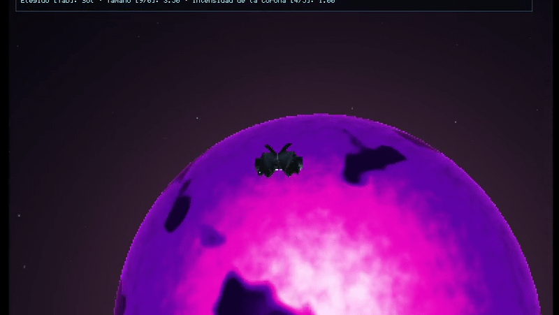 |  | 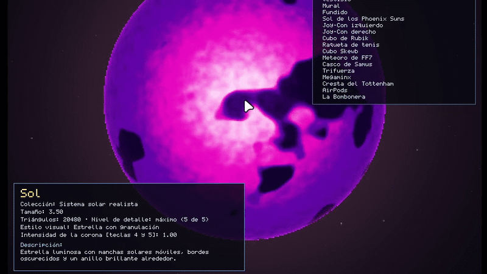 |

## Inicio rápido

1. Elige una opción en el menú principal con `W`/`S` o flechas y pulsa `Enter`.
2. En vuelo, acelera hacia adelante o atrás con `W`/`S` (mantén `Shift` para turbo) y frena con `Espacio`.
3. Gira la nave o la vista con el `Ratón` o las `Flechas`, e inclínala con `Q`/`E`.
4. Pulsa `F` para alternar entre seguir la nave y cámara libre, y `Retroceso` para recentrar.
5. Pulsa `H` en cualquier momento para abrir o cerrar el panel de ayuda, y `Esc` para volver al menú.

## Demostración

[Ver video de demostración del simulador (Google Drive)](https://drive.google.com/file/d/1v4R0i3geqEnqmXdYmj5GmoXdZccOC9qH/view?usp=sharing)

## Requisitos

- **Rust** (edición 2024, `cargo` y `rustc` estables).
- Dependencias de sistema para **Raylib** en Linux (Ubuntu/Debian):
  `cmake`, `libasound2-dev`, `libx11-dev`, `libxrandr-dev`, `libxi-dev`, `libgl1-mesa-dev`, `libglu1-mesa-dev`, `libxcursor-dev`, `libxinerama-dev`.
- Ejecutar siempre con `--release` (`opt-level = 3`, `lto = true`, `codegen-units = 1`) para mantener el rendimiento por encima de 30 FPS.

## Compilación y ejecución

```bash
# Ejecutar el simulador interactivo (resolución interna por defecto 400x300, ventana 800x600, hilos automáticos)
cargo run --release

# Ejecutar la suite de pruebas unitarias
cargo test

# Generar las capturas oficiales en docs/captures/ y docs/captures/ui/ (sin ventana)
cargo run --release -- --docs
```

## Controles

Tabla generada desde `CONTROLS` (`src/hud.rs`):

| Tecla | Acción |
|---|---|
| `W / S` | Acelerar hacia adelante o atrás |
| `Shift` | Turbo para ir más rápido |
| `Espacio` | Frenar poco a poco |
| `Ratón / Flechas` | Girar la vista (en cámara libre) |
| `Q / E` | Inclinar la nave a izquierda o derecha |
| `F / Retroceso` | Cambiar cámara (seguir / libre) · Recentrar |
| `L / G` | Control de vuelo (Auto/Cerca/Libre) · Gravedad |
| `Enter / - =` | Pausar el tiempo · Velocidad del tiempo |
| `Tab` | Elegir el siguiente objeto del sistema |
| `9 / 0` | Cambiar tamaño del objeto elegido |
| `4 / 5` | Ajustar el efecto visual del objeto elegido |
| `, . / [ ]` | Altura y detalle del relieve del planeta |
| `I / O` | Semilla (cambia el reparto aleatorio de objetos) |
| `Z / X / M` | Nivel de detalle · Descartar fuera de vista · Ver la malla (alambre) |
| `B / Y / /` | Relieve fino (normal map) · Ver relieve · Ocultar objetos lejanos |
| `F3 / R / T` | FPS (cuadros por segundo: mide la fluidez) · Calidad de imagen · Núcleos |
| `C / K / P` | Ocultar caras traseras · Recalcular texturas de superficie · Guardar foto |
| `A / D / R` | En galería: cambiar objeto · Reiniciar vista |
| `Esc` | Volver al menú principal (en el menú: salir) |
| `H` | Mostrar u ocultar este panel de ayuda |

## Arquitectura o pipeline

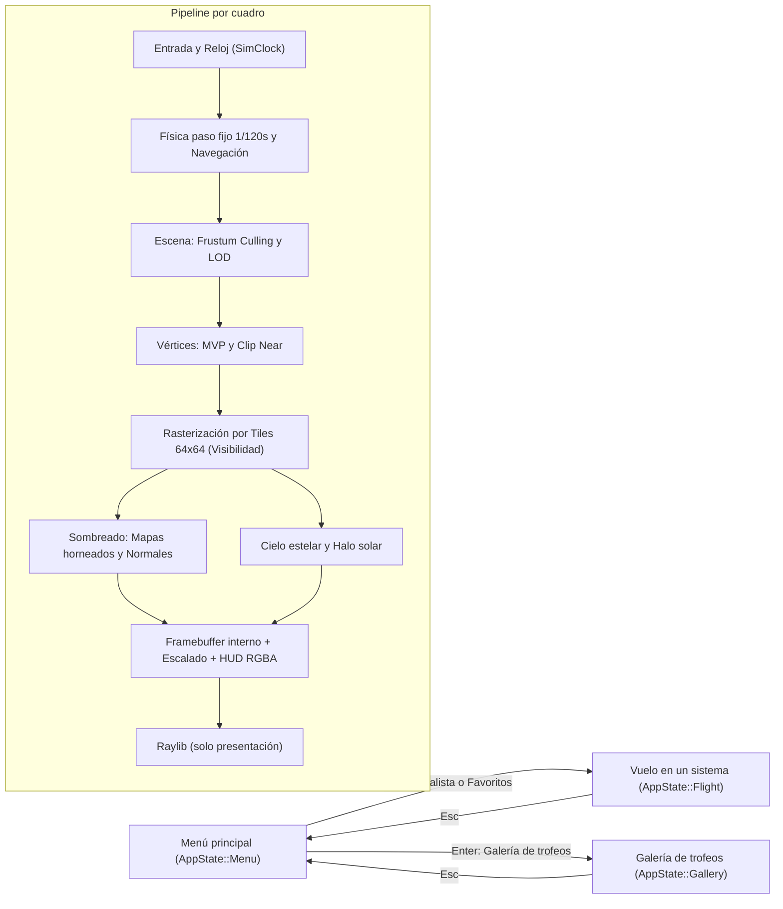

- **Buffer de visibilidad por tiles (`TILE_SIZE = 64`)**: primero se rasterizan todos los triángulos guardando `depth_buffer` y `tri_id_buffer`; el sombreado se ejecuta una sola vez por píxel visible, eliminando el *overdraw* de 2×.
- **Mapas estáticos horneados (`512×256`) + capa animada**: el relieve, biomas y gradientes estáticos se precalculan en mapas equirectangulares y en vivo solo se evalúan animaciones por `time`, atenuación solar y brillo atmosférico.
- **Raylib reducido a ventana, entrada y presentación**: ni la geometría, ni la iluminación, ni el texto del HUD usan funciones de dibujo 3D/texto de Raylib.

Más detalle: [docs/arquitectura.md](docs/arquitectura.md).

## Cuerpos del sistema solar (9)

| | | |
|:---:|:---:|:---:|
| 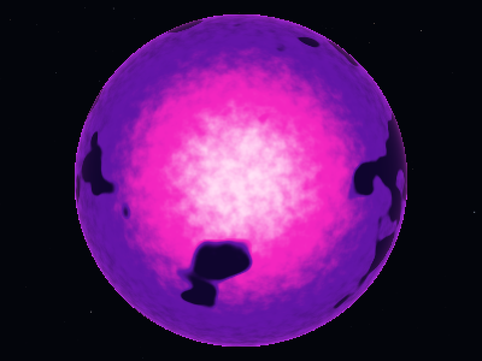<br>**Sol** (`Star`)<br>Estrella emisiva con granulación de manchas, corona animada, sin auto-sombra y halo solar en píxeles vacíos. | <br>**Zebes** (`Rocky`)<br>Planeta rocoso con mar turquesa, biomas, grietas minerales, nubes vivas, relieve deformado y *normal mapping* tangente. | 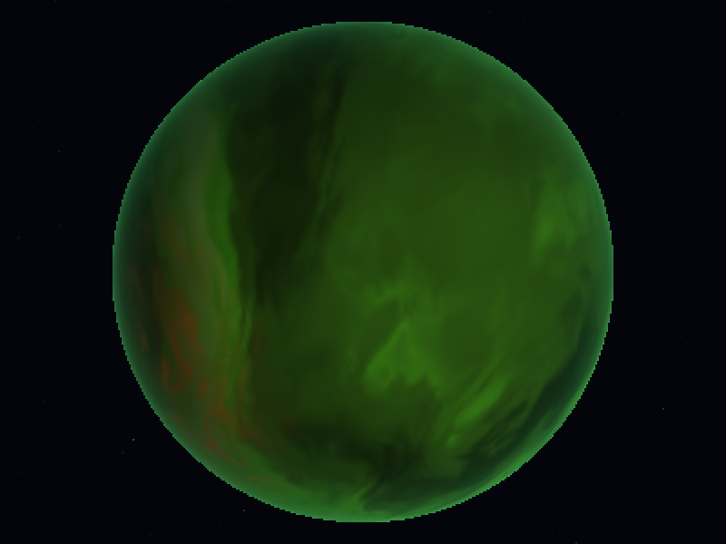<br>**Tau Ceti** (`GasGiant`)<br>Gigante gaseoso con bandas latitudinales turbulentas y gran vórtice ciclónico animado en el hemisferio sur. |
| 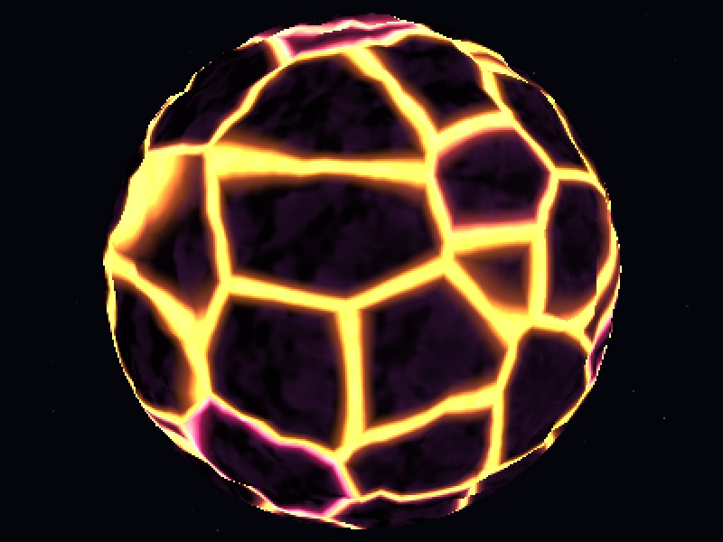<br>**Ardens** (`Ardens`)<br>Placas basálticas Voronoi con relieve direccional y grietas de lava magenta-dorada que laten con géiseres emisivos. | <br>**Abismo** (`Abismo`)<br>Océano 3D con 4 ondas direccionales, cáusticas Voronoi dobles, *maelstrom* polar de 4 brazos y bioluminiscencia nocturna. | <br>**Basquia** (`Basquia`)<br>Lienzo negro con trazos gruesos de *oilstick*/crayón por rejilla 3D, coronas de 3 puntas y conteos animados a ~6 FPS. |
| <br>**Vestigio** (`Vestigio`)<br>Desierto oliva-rosa con dunas anisotrópicas 8×, 4 *dust devils* con estela, desfase cromático VHS, *scanlines* y grano. | <br>**Mural** (`Mural`)<br>Muro de pintura descascarada en 3 capas `fbm` 3D (gris azulado, crema, rojo), grietas *ridge*, tinta y escamas animadas. | <br>**Fundido** (`Fundido`)<br>Superficie en transición térmica con mitad superior salmón y bandas onduladas de magma naranja en el hemisferio sur. |

## Menú principal y galería de trofeos

Al iniciar el simulador se abre el menú principal sobre el sistema solar animado en tiempo real (`src/app.rs`, `src/hud.rs`):

- **Sistema solar realista**: inicia el vuelo en el sistema de 9 cuerpos celestes (Sol + 8 planetas).
- **Sistema de favoritos**: inicia el vuelo en el segundo sistema con el Sol de los Phoenix Suns al centro y 12 objetos favoritos en órbita.
- **Galería de trofeos**: abre el visor individual para inspeccionar los 22 objetos listos (`SHOWCASE_ENTRIES`). Permite cambiar de objeto con `A`/`D`, rotar con el ratón o las flechas, hacer zoom con la rueda, reiniciar la vista con `R`, ajustar el parámetro visual en vivo con `4`/`5` y regresar al menú con `Esc`.
- **Controles**: muestra la tabla completa de teclas directamente sobre el menú.
- **Salir**: cierra la aplicación (o `Esc` desde el menú).

| Menú principal | Controles en el menú | Galería de trofeos | Vuelo con ayuda (`H`) |
|:---:|:---:|:---:|:---:|
| 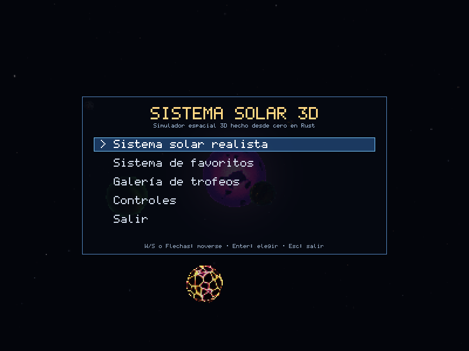 | 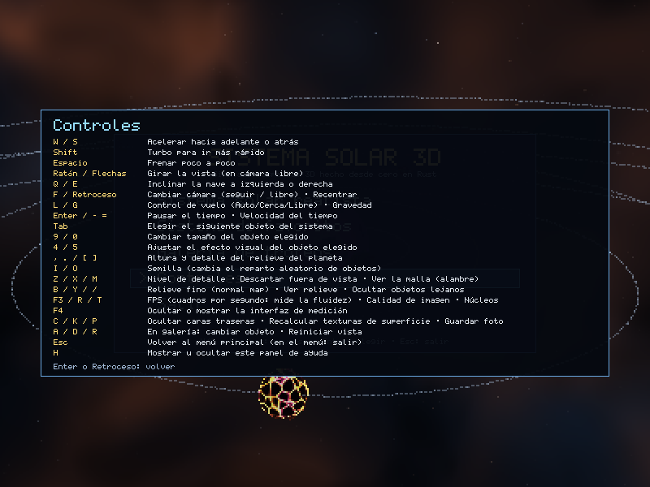 | 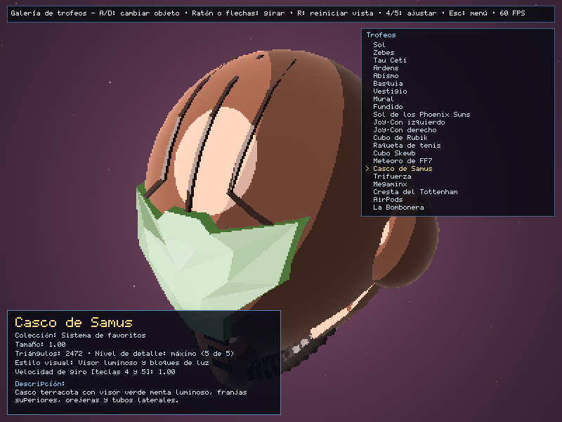 | 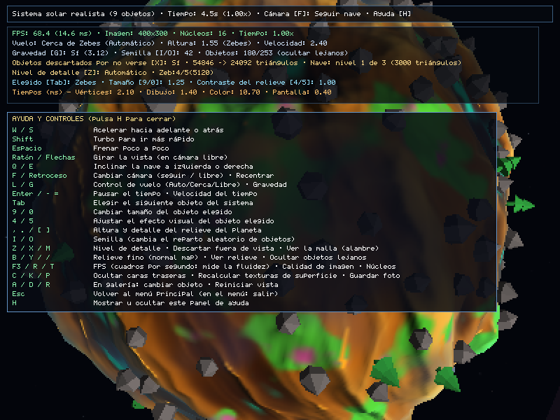 |

## Cuerpos del sistema solar (13)

| | | |
|:---:|:---:|:---:|
| 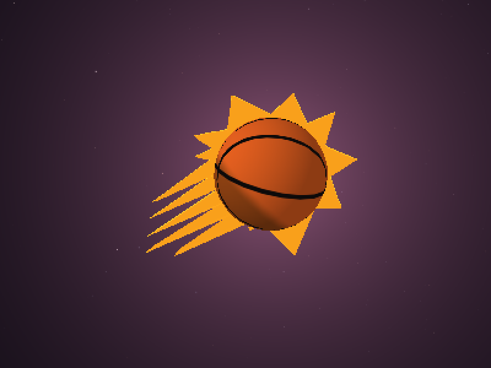<br>**Sol de los Phoenix Suns**<br>Balón de basquetbol en relieve frente a un sol dorado con estela de rayos brillantes.<br><sub>*Técnica:* silueta y rayos medidos de referencia extruidos con bisel + esfera con costuras y oscilación `±30°` (`Shader::PhoenixSuns`).</sub> | 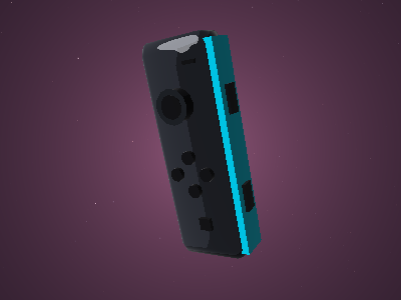<br>**Joy-Con izquierdo**<br>Control izquierdo gris mate con riel azul neón, palanca y cruceta de cuatro botones.<br><sub>*Técnica:* caja redondeada estanca con primitivas y colores por vértice (`Shader::Chunky`, 3 niveles de detalle).</sub> | 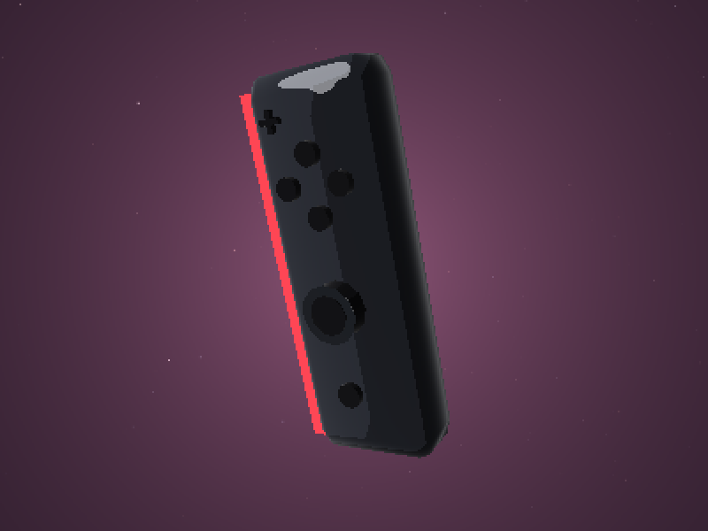<br>**Joy-Con derecho**<br>Control derecho gris mate con riel rojo neón, palanca y los cuatro botones en rombo.<br><sub>*Técnica:* geometría espejada con botones ABXY, `+` y `Home` por color de vértice (`Shader::Chunky`).</sub> |
| 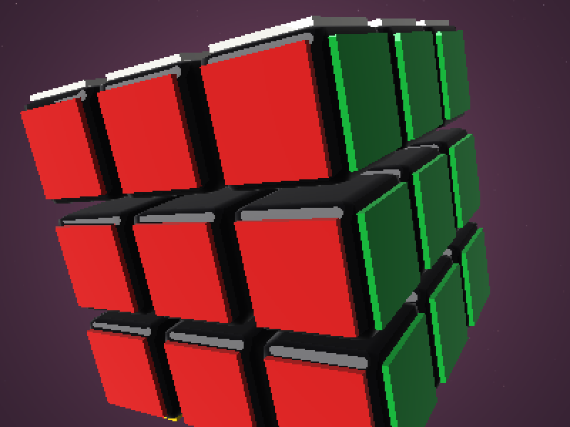<br>**Cubo de Rubik**<br>Rompecabezas clásico formado por 27 piezas negras con sus seis caras de colores vivos.<br><sub>*Técnica:* 27 cubos con holgura y pegatinas elevadas por cara (`Shader::Chunky`, `108`/`324`/`3564` triángulos).</sub> | 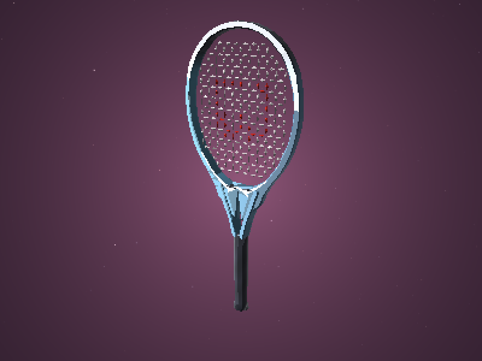<br>**Raqueta de tenis**<br>Raqueta con marco brillante en turquesa y azul, mango oscuro y cuerdas con la W roja al centro.<br><sub>*Técnica:* perfil y contorno medidos barridos con `sweep_profile`, barniz especular (`material_id = 1`) y cuerdas `11×13` de octaedros.</sub> | 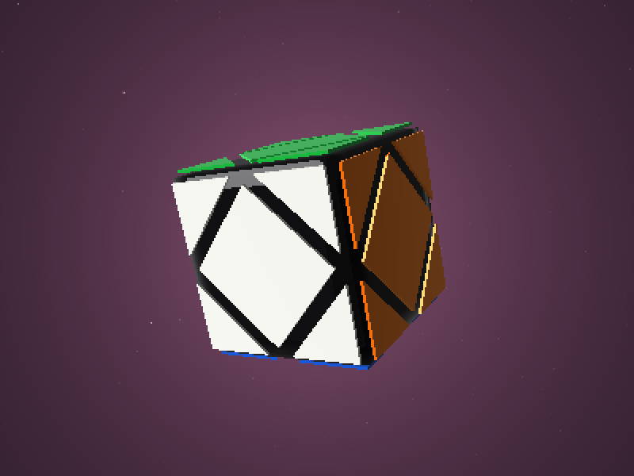<br>**Cubo Skewb**<br>Rompecabezas cúbico de giro diagonal con un rombo central y cuatro triángulos por cara.<br><sub>*Técnica:* cubo base con rombo y cuatro triángulos rectángulos elevados por cara (`Shader::Chunky`).</sub> |
| 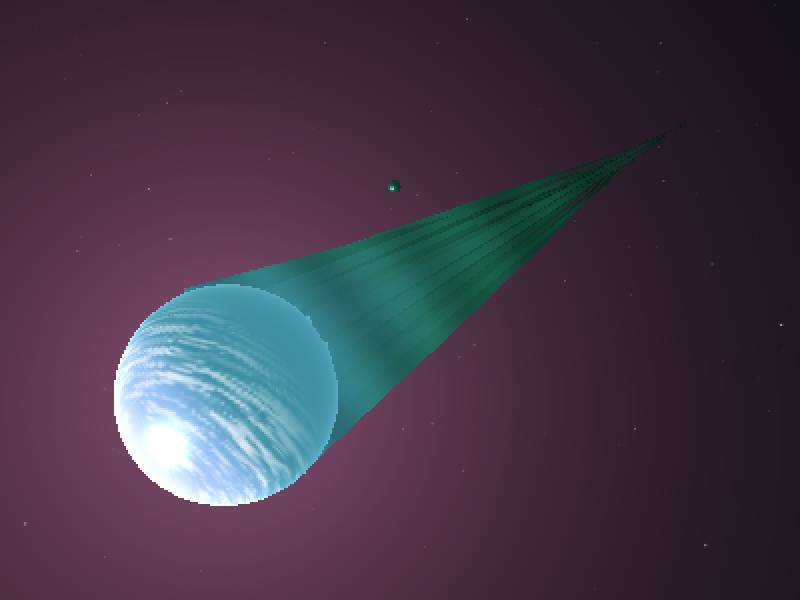<br>**Meteoro de FF7**<br>Cometa verde azulado de cabeza brillante con trazos en espiral y cola alargada de pinceladas.<br><sub>*Técnica:* icosfera vítrea con espiral horneada, cola de pinceladas con degradado por vértice y orbe (`Shader::Meteor`).</sub> | 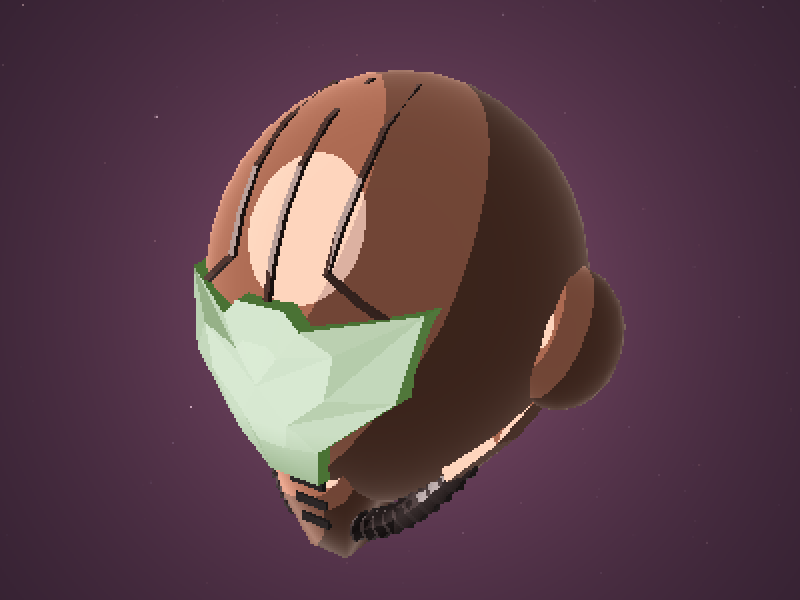<br>**Casco de Samus**<br>Casco terracota con visor verde menta luminoso, franjas superiores, orejeras y tubos laterales.<br><sub>*Técnica:* domo ajustado al perfil radial medido, surcos adelgazados, visor emisivo curvo (`material_id = 2`) y tubos acanalados.</sub> | 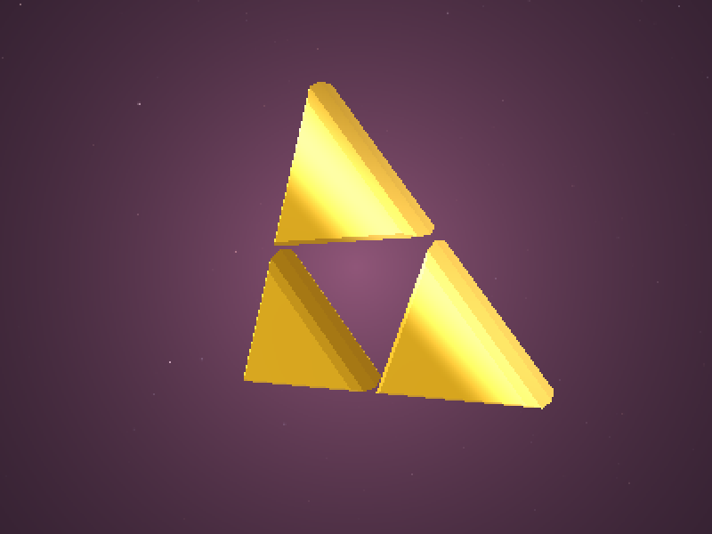<br>**Trifuerza**<br>Tres triángulos dorados con brillo metálico y un destello suave que recorre sus caras.<br><sub>*Técnica:* tres prismas triangulares equiláteros con centro hueco (`Shader::Triforce`, `24`/`42`/`78` triángulos).</sub> |
| 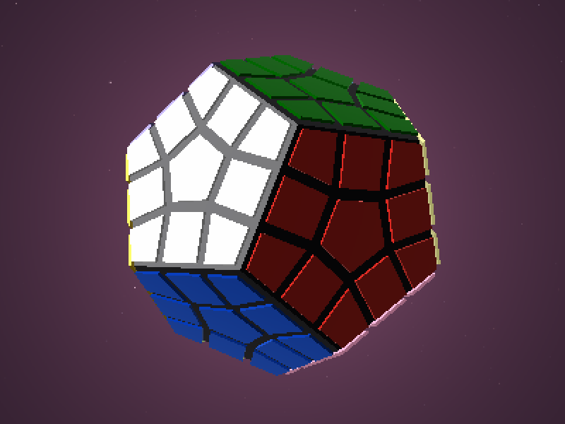<br>**Megaminx**<br>Rompecabezas de doce caras pentagonales con once piezas de colores distintos en cada lado.<br><sub>*Técnica:* dodecaedro regular con 11 pegatinas por cara en el esquema estándar de 12 colores DaYan (`Shader::Chunky`).</sub> | 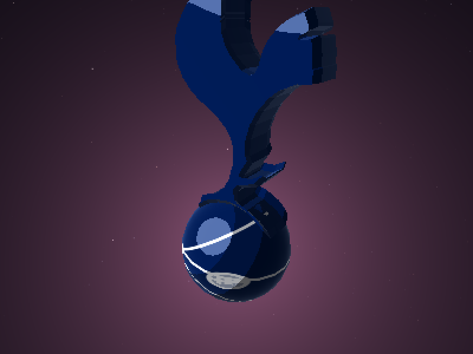<br>**Cresta del Tottenham**<br>Gallo azul marino en relieve posado sobre un balón con costuras y cordones blancos.<br><sub>*Técnica:* silueta medida extruida con bisel sobre balón 3D con parches y oscilación `±35°` (`Shader::Spurs`).</sub> | 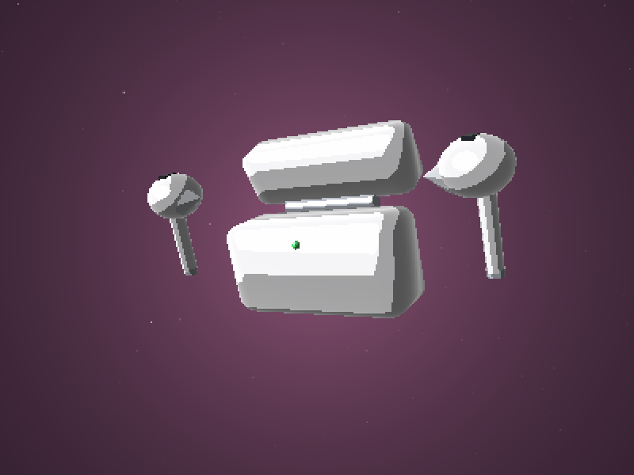<br>**AirPods**<br>Estuche blanco brillante con tapa entreabierta, luz frontal y par de auriculares en su interior.<br><sub>*Técnica:* caja redondeada con tapa abierta a `70°`, bisagra cilíndrica, LED y auriculares espejados (`Shader::Chunky`).</sub> |
| 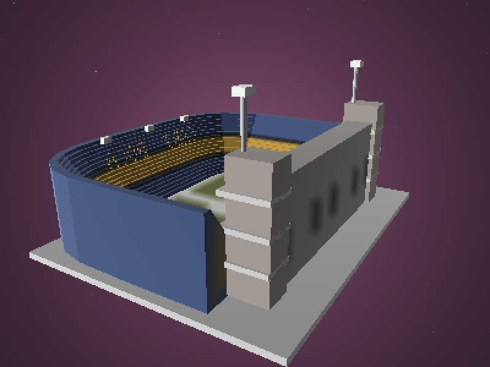<br>**La Bombonera**<br>Estadio en forma de D con tres lados de gradas azul y amarillo, edificio de palcos y cancha verde.<br><sub>*Técnica:* gradas escalonadas en D, letras con la fuente `5×7`, edificio de palcos con ventanas y cancha `105:68` (`Shader::Chunky`).</sub> | | |

### Cómo se construyen los cuerpos del sistema de favoritos

- **Constructor de mallas estancas (`src/mesh_builder.rs`)**: todos los cuerpos se ensamblan en código a partir de primitivas cerradas (`box_mesh`, `rounded_box`, `cylinder`, `cone`, `sphere`, `torus`, `extruded_prism`, `loft_rings`, `sweep_profile`, `raised_sticker`) con color por vértice interpolado en perspectiva y verificación topológica en pruebas (`is_watertight`, `outward_normal_ratio`).
- **Niveles de detalle por reconstrucción (`LodMeshCache`)**: cada cuerpo implementa 3 niveles de detalle (`detail = 0, 1, 2`) que reconstruyen la geometría con distinta densidad de segmentos y detalles según la distancia en vuelo o el presupuesto de cuadro en la galería.
- **Medición desde referencias locales (`tools/`)**: las siluetas, proporciones y paletas de los cuerpos basados en objetos reales se midieron con scripts propios (`tools/trace_logo.py`, `tools/measure_racket.py`, `tools/measure_samus_bombonera.py`) sobre imágenes de referencia locales en `refs/`. Las imágenes de `refs/` no se distribuyen en el repositorio (están ignoradas en `.gitignore`).

## Componentes principales

### Motor MVP y recorte
Construye las transformaciones de modelo (`T·R·S`), cámara (`look_at_rh`) y proyección perspectiva (`perspective_rh`) en mano derecha mirando hacia `-Z`, y recorta triángulos contra el plano cercano (`clip_near_plane`) antes de dividir por `w`.
- **Variable en código**: `fov_y = 45°`, `near = 0.1`, `far = 400.0` (`src/camera.rs`, `src/main.rs`) y `DEGENERATE_EPS = 1e-6` (`src/rasterizer.rs`).


### Rasterizador y rendimiento
Divide la pantalla en *tiles* de `64×64` procesados en paralelo con `std::thread::scope` y utiliza un buffer de visibilidad (`depth_buffer` + `tri_id_buffer`) para sombrear una sola vez por píxel visible, descartando esferas fuera del frustum antes de ensamblar triángulos.
- **Variable en código**: `TILE_SIZE = 64` (`src/rasterizer.rs`) y `res_scales = [2, 3, 1]` (`src/main.rs`, tecla `R`).

| Culling ON | Culling OFF |
|:---:|:---:|
|  | 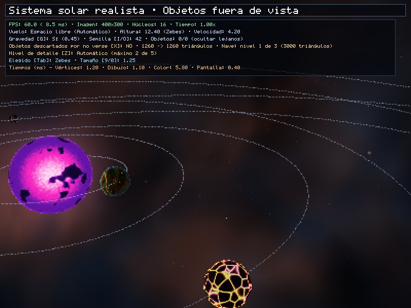 |

### Navegación
Integra movimiento 6-DOF y gravedad a paso fijo (`FIXED_DT`) independiente del FPS, usando colisión contra el radio efectivo deformado y cambio automático con histéresis entre marco global y marco local del planeta más cercano.
- **Variable en código**: `FIXED_DT = 1.0 / 120.0`, `GRAVITY_G = 7.2` (`src/physics.rs`) y `LOCAL_ENTER_RADII = 2.5` / `LOCAL_EXIT_RADII = 3.0` (`src/nav.rs`).

| Modo Local | Nave 3D |
|:---:|:---:|
| 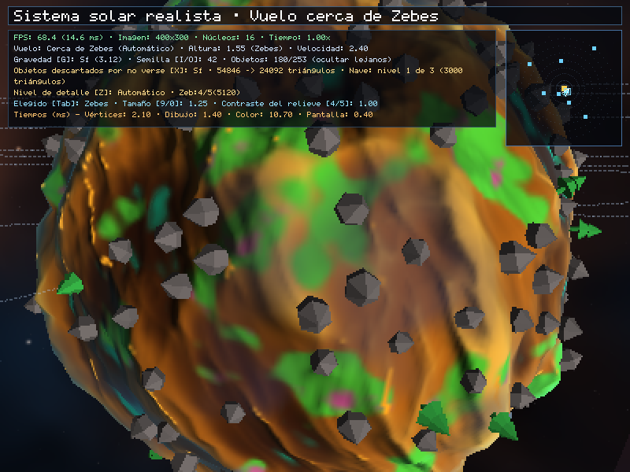 |  |

### Planetas y shaders
Orquesta los 9 cuerpos celestes con configuración centralizada (escalado de órbitas para un recorrido de ~1 min, atenuación solar con ambiente mínimo, halo solar en píxeles vacíos y brillo atmosférico Fresnel por planeta) y parámetro en vivo por shader.
- **Variable en código**: `ORBIT_DISTANCE_SCALE = 0.65`, `ORBIT_SPEED_SCALE = 1.15`, `MIN_AMBIENT = 0.14`, `SOLAR_ATTENUATION_K = 0.00055` (`src/scene_config.rs`) y `live_param` (`src/shaders.rs`, teclas `4`/`5`).

| Sistema solar completo | Sistema de favoritos |
|:---:|:---:|
|  | 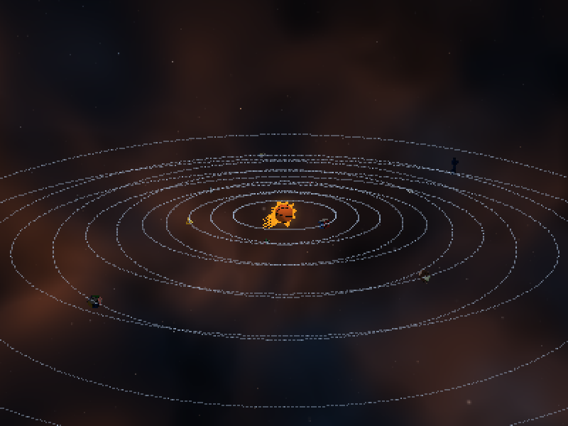 |

### Relieve y normales
Genera icosferas procedurales (`0..=5`) deformadas por la misma función `height_at` del horneado, selecciona el nivel LOD según el radio proyectado en pantalla con histéresis y perturba las normales en espacio tangente en `Zebes`.
- **Variable en código**: `ICOSPHERE_THRESHOLDS_PX = [8.0, 18.0, 40.0, 85.0, 160.0]`, `DEFAULT_HYSTERESIS = 0.12` (`src/lod.rs`) y `deformation_amplitude` / `noise_frequency` (`src/scene.rs`, teclas `,`/`.` y `[`/`]`).

| Normales ON | Deformación alta |
|:---:|:---:|
| 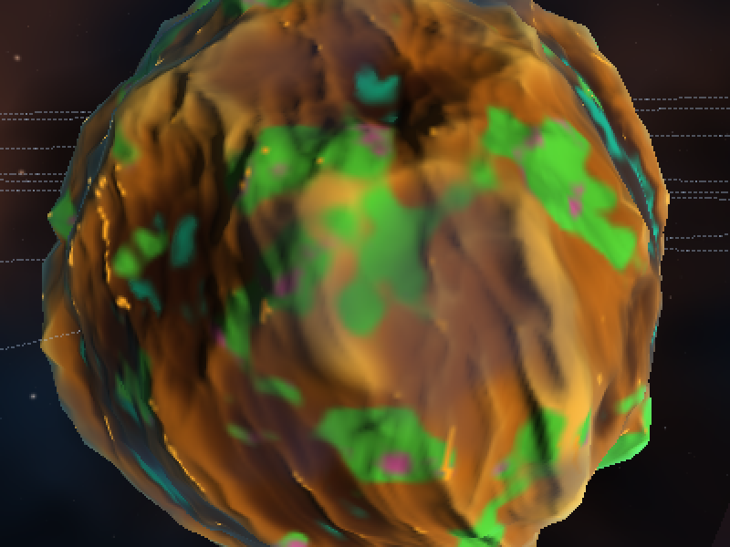 | 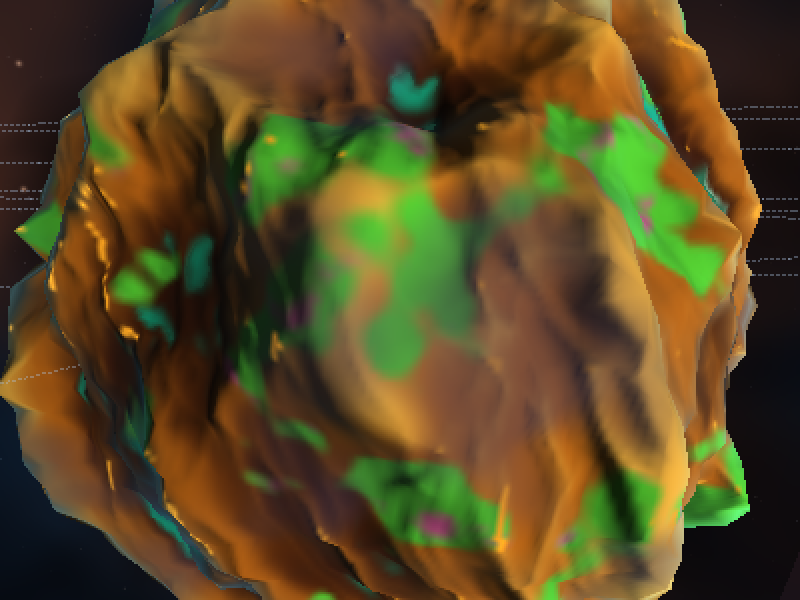 |

### Superficie
Distribuye instancias sobre la esfera con espiral de Fibonacci, perturbación `SplitMix64` y filtrado por ruido procedural, orientando cada objeto según la normal deformada y aplicando *frustum culling* y LOD por distancia.
- **Variable en código**: `surface_seed = 42` (`src/main.rs`, teclas `I`/`O`), `MAX_PROP_DISTANCE = 32.0` (`src/main.rs`) e `INSTANCE_LOD_DIST = 12.0` (`src/lod.rs`).

| Semilla 42 | Semilla 99 |
|:---:|:---:|
|  | 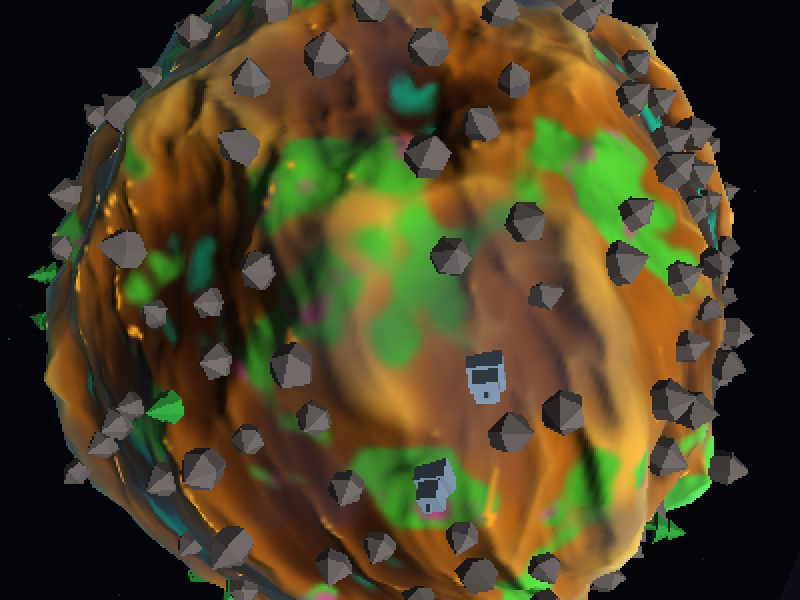 |

### HUD
Dibuja la barra de título, telemetría, contadores de culling/LOD, selección de cuerpos (`Tab`) y el panel de ayuda (`H`) mediante una fuente bitmap `5×7` propia sobre un `OverlayBuffer` RGBA compuesto al presentar sin texto de Raylib.
- **Variable en código**: `GLYPH_WIDTH = 5`, `GLYPH_HEIGHT = 7` y tabla `CONTROLS` (`src/hud.rs`).


## Rúbrica y trazabilidad

La rúbrica suma **200 puntos**, pero la **nota máxima es 100 puntos**. La tabla siguiente reproduce los criterios oficiales y enlaza cada uno con su implementación en el proyecto.

| Categoría | Característica evaluada | Puntos | Máximo | Estado y evidencia en el proyecto |
|---|---|---:|---:|---|
| **Planetas** | Planeta distinguible que orbita, rota y puede observarse de cerca sin que el programa truene o el rendimiento se degrade mucho | 10 por planeta | **50** (5 planetas) | ✅ 8 planetas distinguibles, además del Sol, definidos en `src/scene.rs::solar_system`; órbitas y rotaciones en `body_position_at` y `body_model_matrix_at`. Se recorren con `Tab` y se documentan en `docs/captures/`. |
| **Superficie** | Tipo de modelo propio colocado sobre un planeta: árbol, roca, edificio o monumento | 5 por tipo | **20** (4 tipos) | ✅ Los cuatro tipos se generan en `src/surface_props.rs::placeholder_mesh` con LOD alto y bajo. |
| **Superficie** | Distribución procedural reproducible de varias instancias sobre la superficie, usando los algoritmos de ruido vistos en clase | 10 | **10** | ✅ Espiral de Fibonacci, `SplitMix64` y ruido 3D en `src/surface_scatter.rs`; la semilla se modifica con `I`/`O`. |
| **Superficie** | Posición y orientación correctas de objetos sobre la superficie curva mientras el planeta rota | 5 | **5** | ✅ `surface_point_and_normal` calcula la superficie deformada e `instance_local_matrix` alinea el eje vertical con su normal. |
| **Renderizado** | Shader propio con un efecto visual claramente distinguible | 6 por shader | **24** (4 shaders) | ✅ Hay shaders separados para Sol, Zebes, Tau Ceti, Ardens, Abismo, Basquia, Vestigio, Mural y Fundido en `src/shaders/`; cuatro son puntuables. |
| **Renderizado** | Shader animado cuyo efecto cambia con el tiempo | 8 | **8** | ✅ Nubes, bandas, lava, océano, trazos y otros efectos reciben `time`; se puede pausar o variar la velocidad con `Enter`, `-` y `=`. |
| **Renderizado** | Mapeo de normales implementado en el renderizador por software | 8 | **8** | ✅ Base tangente y perturbación de normales en Zebes; se compara en vivo con `B` y en `normales_on.png`/`normales_off.png`. |
| **Renderizado** | Deformación de la geometría de un planeta mediante ruido u otra función | 10 | **10** | ✅ `deform_icosphere_for_shader` usa la misma función de altura que el horneado; amplitud y frecuencia se ajustan con `,`/`.` y `[`/`]`. |
| **Renderizado** | Etapa propia de generación o subdivisión procedural de geometría antes de rasterizar | 10 | **10** | ✅ Icosferas procedurales de niveles 0 a 5 en `src/icosphere.rs`, seleccionadas por LOD con histéresis antes del pipeline de rasterización. |
| **Navegación** | Modo de control local que facilita rodear un planeta cercano sin cortar el vuelo | 8 | **8** | ✅ Marco local/global automático con histéresis en `src/nav.rs`; `L` permite cambiar el modo. |
| **Navegación** | Aceleración, frenado y giro progresivos, con respuesta consistente entre equipos de distinta velocidad | 8 | **8** | ✅ Física a paso fijo de `1/120 s`, empuje, turbo, frenado y rotación independientes del FPS en `src/physics.rs`, `src/nav.rs` y `src/ship.rs`. |
| **Navegación** | Atracción gravitatoria de los planetas que modifica la trayectoria de la nave | 10 | **10** | ✅ Gravedad de todos los cuerpos con ley de inverso al cuadrado, ablandamiento y aceleración máxima en `gravity_acceleration`; se alterna con `G`. |
| **Navegación** | Colisión básica que impide atravesar el planeta | 4 | **4** | ✅ Detección y resolución esfera-esfera contra el radio efectivo deformado en `src/physics.rs`. |
| **Rendimiento** | Descartar objetos fuera de la vista antes de rasterizarlos | 7 | **7** | ✅ *Frustum culling* por esferas envolventes en `src/culling.rs`; se activa/desactiva con `X`. |
| **Rendimiento** | Usar distintas cantidades de detalle según la distancia a un planeta u objeto | 8 | **8** | ✅ LOD para planetas, nave, modelos de superficie y cuerpos de la galería; `Z` permite inspeccionarlo. |
| **Presentación** | Coherencia visual y composición de la escena | hasta 5 | **5** | ✅ Dos sistemas con identidad visual consistente, fondo estelar, iluminación, halos, HUD y galería. |
| **Presentación** | Claridad de la experiencia: controles comprensibles y recorrido fácil de seguir | hasta 5 | **5** | ✅ Menú principal, panel de controles, ayuda con `H`, selección con `Tab` y telemetría en pantalla. |
| | **Total disponible** | | **200** | **Nota máxima: 100 puntos.** |

El menú principal, el segundo sistema de favoritos con 13 cuerpos y la galería de trofeos son extras de presentación; no aumentan los topes de la rúbrica.

## Verificación de reglas

1. **Sin funciones 3D ni texto de Raylib para renderizar/HUD**: ✅ Cumplido; Raylib solo crea la ventana, lee entrada y presenta las dos texturas (`framebuffer` + `OverlayBuffer` en `src/framebuffer.rs::draw_with_overlay`).
2. **Mínimo 30 FPS a resolución interna por defecto (`400×300`)**: ✅ Cumplido (`58.6–135.5 FPS` en `docs/rendimiento.md` y `36.5–217.9 FPS` en los shaders nuevos).
3. **Al menos 5 planetas y 4 shaders procedurales distintos**: ✅ Cumplido (1 estrella + 8 planetas con 9 shaders distintos sin repetir técnicas).
4. **Una sola función `height_at` para deformación, horneado y normales**: ✅ Cumplido (`src/surface_map.rs::shader_height` alimenta `deform_icosphere_for_shader`, `BakedMaps` y `surface_point_and_normal`).
5. **Distribución procedural reproducible sin posiciones hardcodeadas**: ✅ Cumplido (`src/rng.rs::SplitMix64` + `src/surface_scatter.rs::fibonacci_sphere_points`).

## Estructura del proyecto

```text
proy3-graficas/
├── .github/workflows/ci.yml
├── assets/
│   ├── ship.obj
│   ├── ship_lod0.obj
│   ├── ship_lod1.obj
│   ├── ship_lod2.obj
│   └── sphere.obj
├── docs/
│   ├── captures/                # Capturas oficiales (--docs: 45 principales + 26 de interfaz en ui/)
│   ├── gifs/                    # Espacio reservado para los GIF de portada
│   ├── arquitectura.md
│   ├── auditoria-paletas.md
│   ├── auditoria-rubrica.md
│   ├── blender.md
│   ├── defensa.md
│   ├── guion-video.md
│   ├── medidas-raqueta.md
│   ├── medidas-samus-bombonera.md
│   ├── rendimiento.md
│   ├── reuse-audit.md
│   └── textos-interfaz.md
├── src/
│   ├── app.rs
│   ├── bodies.rs
│   ├── camera.rs
│   ├── clipping.rs
│   ├── culling.rs
│   ├── docs_capture.rs
│   ├── fragment.rs
│   ├── framebuffer.rs
│   ├── gallery.rs
│   ├── hud.rs
│   ├── icosphere.rs
│   ├── lod.rs
│   ├── logo_data.rs
│   ├── main.rs
│   ├── math.rs
│   ├── mesh_builder.rs
│   ├── mesh_lod.rs
│   ├── nav.rs
│   ├── noise.rs
│   ├── obj.rs
│   ├── perf.rs
│   ├── physics.rs
│   ├── primitive.rs
│   ├── racket_data.rs
│   ├── rasterizer.rs
│   ├── rng.rs
│   ├── samus_bombonera_data.rs
│   ├── scene.rs
│   ├── scene_config.rs
│   ├── shaders/                 # abismo, ardens, basquia, chunky, fundido, gas_giant, meteor,
│   │                            # mural, rocky, ship, spurs, star, suns, triforce, vestigio
│   ├── shaders.rs
│   ├── ship.rs
│   ├── showcase.rs
│   ├── sim.rs
│   ├── sky.rs
│   ├── surface_map.rs
│   ├── surface_props.rs
│   ├── surface_scatter.rs
│   └── vertex.rs
├── tools/
│   ├── make_ship_lods.py
│   ├── measure_racket.py
│   ├── measure_samus_bombonera.py
│   └── trace_logo.py
├── Cargo.toml
└── README.md
```

## Limitaciones conocidas

- El renderizador trabaja completamente en CPU. La configuración recomendada es `--release`, resolución interna de `400×300` y todos los hilos disponibles; el rendimiento depende del procesador. Las mediciones publicadas se hicieron con 16 hilos y no garantizan los mismos FPS en otro equipo.
- La ventana de ejecución tiene un tamaño fijo de `800×600`. La imagen 3D se renderiza por defecto a `400×300` y se escala, por lo que puede verse pixelada; `R` alterna entre `400×300`, `266×200` y `800×600`. A resolución interna completa, los shaders más costosos pueden caer por debajo de 30 FPS al observarlos muy de cerca.
- Los cuatro archivos `.obj` opcionales de superficie (`assets/surface/{tree,rock,building,monument}.obj`) no están incluidos. El proyecto usa sus cuatro modelos procedurales de respaldo definidos en `src/surface_props.rs`, de menor complejidad visual.
- Los objetos de superficie solo se distribuyen en planetas con shader rocoso y se ocultan a más de `32` unidades. No tienen colisión propia: la nave colisiona con una envolvente esférica del planeta basada en su radio y deformación máxima, no con cada relieve u objeto visible.
- Las órbitas de los cuerpos son trayectorias analíticas predefinidas; la gravedad modifica la nave, pero los planetas no se perturban entre sí ni reaccionan a la nave.
- La física procesa como máximo 8 subpasos por cuadro. Tras una pausa larga o un cuadro de más de `0.25 s`, descarta tiempo acumulado para evitar una espiral de actualizaciones, de modo que la simulación puede perder continuidad temporal durante bloqueos severos.
- Las imágenes de referencia usadas para medir siluetas y colores (`refs/`) están excluidas por `.gitignore`; el repositorio conserva únicamente los datos derivados en `src/logo_data.rs`, `src/racket_data.rs` y `src/samus_bombonera_data.rs`.

## Dependencias principales

- `raylib = "6.0.0"` (con `SUPPORT_IMAGE_GENERATION`): ventana, lectura de teclado/ratón, carga/actualización de textura y exportación de PNG.
- Biblioteca estándar de Rust (`std::thread::scope`): paralelismo por bandas/tiles sin dependencias externas.


## Autor

**Marcelo Detlefsen** - Carné 24554  
*Universidad del Valle de Guatemala*  
*Gráficas por Computadora - Proyecto 3*
