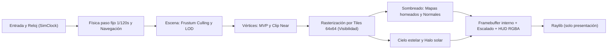

# Proyecto 3 — Sistema Solar por Software (Rust + Raylib)

[](https://github.com/MarceloDetlefsen/proy3-graficas/actions/workflows/ci.yml)

Renderizador 3D por software escrito en Rust que simula un sistema solar navegable con 9 cuerpos celestes (1 estrella y 8 planetas con shaders procedurales propios). Implementa pipeline `MVP` propio en mano derecha, recorte en espacio de clip contra el plano cercano, *frustum culling* por esferas envolventes, *backface culling*, rasterizador por *tiles* de `64×64` con buffer de visibilidad y paralelismo mediante `std::thread::scope`, icosferas procedurales con deformación radial y *LOD* con histéresis, mapeo de normales en espacio tangente, distribución procedural sobre la superficie con espiral de Fibonacci y `SplitMix64`, física a paso fijo (`1/120 s`) con gravedad y modo local/global, y un HUD RGBA propio con fuente bitmap `5×7`.


## Demostración

<<COMPLETAR: enlace al video>>

## Requisitos

- **Rust** (edición 2024, `cargo` y `rustc` estables).
- Dependencias de sistema para **Raylib** en Linux (Ubuntu/Debian):
  `cmake`, `libasound2-dev`, `libx11-dev`, `libxrandr-dev`, `libxi-dev`, `libgl1-mesa-dev`, `libglu1-mesa-dev`, `libxcursor-dev`, `libxinerama-dev`.
- Ejecutar siempre con `--release` (`opt-level = 3`, `lto = true`, `codegen-units = 1`) para mantener el rendimiento por encima de 30 FPS.

## Compilación y ejecución

```bash
# Ejecutar el simulador interactivo (resolución interna por defecto 400x300, ventana 800x600, hilos automáticos)
cargo run --release

# Ejecutar la suite de pruebas unitarias
cargo test

# Generar las 23 capturas oficiales en docs/captures/ (sin ventana)
cargo run --release -- --docs
```

## Controles

Tabla generada desde `CONTROLS` (`src/hud.rs`):

| Acción | Tecla |
|---|---|
| Empuje adelante / atrás | `W / S` |
| Impulso (boost) | `Shift` |
| Frenado progresivo | `Espacio` |
| Cabeceo y guiñada (cámara en Libre) | `Mouse/Flechas` |
| Alabeo (roll) | `Q / E` |
| Cámara Seguir/Libre / Recentrar | `F / Backspace` |
| Modo control (Auto/Local/Global) / Gravedad | `L / G` |
| Pausar simulación / Escala de tiempo | `Enter / - =` |
| Seleccionar cuerpo siguiente | `Tab` |
| Ajustar radio del cuerpo seleccionado | `9 / 0` |
| Ajustar parámetro en vivo del shader | `4 / 5` |
| Amplitud / Frecuencia de deformación | `, . / [ ]` |
| Cambiar semilla de distribución | `I / O` |
| Forzar LOD / Frustum culling / Wireframe | `Z / X / M` |
| Normal map / Debug normales / Cull instancias | `B / Y / /` |
| Métricas / Resolución interna / Hilos | `F3 / R / T` |
| Backface culling / Re-hornear / Captura PNG | `C / K / P` |
| Mostrar u ocultar este panel de ayuda | `H` |

## Arquitectura o pipeline



- **Buffer de visibilidad por tiles (`TILE_SIZE = 64`)**: primero se rasterizan todos los triángulos guardando `depth_buffer` y `tri_id_buffer`; el sombreado se ejecuta una sola vez por píxel visible, eliminando el *overdraw* de 2×.
- **Mapas estáticos horneados (`512×256`) + capa animada**: el relieve, biomas y gradientes estáticos se precalculan en mapas equirectangulares y en vivo solo se evalúan animaciones por `time`, atenuación solar y brillo atmosférico.
- **Raylib reducido a ventana, entrada y presentación**: ni la geometría, ni la iluminación, ni el texto del HUD usan funciones de dibujo 3D/texto de Raylib.

Más detalle: [docs/arquitectura.md](docs/arquitectura.md).

## Componentes principales

### Motor MVP y recorte
- **Evidencia**: [culling_on.png](docs/captures/culling_on.png), `src/math.rs` (`Mat4::perspective_rh`, `Mat4::look_at_rh`), `src/clipping.rs` (`clip_near_plane`).

| Parámetro o constante | Qué cambia |
|---|---|
| `fov_y = 45°`, `near = 0.1`, `far = 400.0` | Campo de visión y planos de recorte de la cámara |
| `DEGENERATE_EPS = 1e-6` (`src/rasterizer.rs`) | Umbral para descartar triángulos degenerados |

### Rasterizador y rendimiento
- **Evidencia**: [culling_off.png](docs/captures/culling_off.png), `src/rasterizer.rs` (`rasterize_visibility_tiled`, `shade_visibility_tiled_materials`), `docs/rendimiento.md`.

| Parámetro o constante | Qué cambia |
|---|---|
| `TILE_SIZE = 64` | Tamaño de tile (`64×64` px) para paralelismo y caché |
| `res_scales = [2, 3, 1]` | Resolución interna (`400×300`, `266×200`, `800×600`) con tecla `R` |

### Navegación
- **Evidencia**: [modo_local.png](docs/captures/modo_local.png), [nave.png](docs/captures/nave.png), `src/physics.rs` (`PhysicsStepper`), `src/nav.rs` (`NavState`).

| Parámetro o constante | Qué cambia |
|---|---|
| `FIXED_DT = 1.0 / 120.0`, `MAX_SUBSTEPS = 8` | Paso fijo de física independiente del FPS |
| `GRAVITY_G = 7.2`, `MAX_GRAVITY_ACCEL = 15.0` | Intensidad y cota de la atracción gravitacional |
| `LOCAL_ENTER_RADII = 2.5`, `LOCAL_EXIT_RADII = 3.0` | Histéresis de entrada/salida al marco local del planeta |

### Planetas y shaders
- **Evidencia**: [sol.png](docs/captures/sol.png), [zebes.png](docs/captures/zebes.png), [tau_ceti.png](docs/captures/tau_ceti.png), [ardens.png](docs/captures/ardens.png), [abismo.png](docs/captures/abismo.png), [basquia.png](docs/captures/basquia.png), [vestigio.png](docs/captures/vestigio.png), [mural.png](docs/captures/mural.png), [fundido.png](docs/captures/fundido.png); `src/scene.rs` (`solar_system`), `src/scene_config.rs`, `src/shaders.rs` (`live_param`).

| Parámetro o constante | Qué cambia |
|---|---|
| `ORBIT_DISTANCE_SCALE = 0.65`, `ORBIT_SPEED_SCALE = 1.15` | Escala de órbitas para recorrido completo de ~1 minuto |
| `MIN_AMBIENT = 0.14`, `SOLAR_ATTENUATION_K = 0.00055` | Ambiente mínimo y atenuación de la luz solar por distancia |
| `live_param` (`0.25..=2.0`, paso `0.15`) | Modulador en vivo por shader con teclas `4` / `5` |

### Relieve y normales
- **Evidencia**: [normales_on.png](docs/captures/normales_on.png), [normales_off.png](docs/captures/normales_off.png), [deform_baja.png](docs/captures/deform_baja.png), [deform_alta.png](docs/captures/deform_alta.png), [lod_cerca.png](docs/captures/lod_cerca.png), [lod_lejos.png](docs/captures/lod_lejos.png); `src/icosphere.rs` (`deform_icosphere_for_shader`), `src/lod.rs`.

| Parámetro o constante | Qué cambia |
|---|---|
| `ICOSPHERE_THRESHOLDS_PX = [8, 18, 40, 85, 160]` | Umbrales de radio en píxeles para LOD `0..=5` |
| `DEFAULT_HYSTERESIS = 0.12` | Banda muerta de histéresis en cambio de LOD |

### Superficie
- **Evidencia**: [semilla_42.png](docs/captures/semilla_42.png), [semilla_99.png](docs/captures/semilla_99.png); `src/surface_scatter.rs` (`scatter_for_body`), `src/rng.rs` (`SplitMix64`).

| Parámetro o constante | Qué cambia |
|---|---|
| `surface_seed = 42` | Semilla inicial de distribución (ajustable con `I` / `O`) |
| `MAX_PROP_DISTANCE = 32.0`, `INSTANCE_LOD_DIST = 12.0` | Distancia máxima de dibujado y cambio de LOD de instancias |

### HUD
- **Evidencia**: [ayuda_hud.png](docs/captures/ayuda_hud.png); `src/hud.rs` (`glyph_5x7`, `OverlayBuffer`, `CONTROLS`, `render_hud`), `src/framebuffer.rs` (`draw_with_overlay`).

| Parámetro o constante | Qué cambia |
|---|---|
| `GLYPH_WIDTH = 5`, `GLYPH_HEIGHT = 7` | Fuente bitmap propia (ASCII 32–126 + `á é í ó ú ñ ¿ ¡`) |

## Funcionalidades o criterios evaluables

| Criterio | Pts | Cumple | Dónde verlo | Archivo y función | Parámetro modificable |
|---|---:|:---:|---|---|---|
| Pipeline propio (MVP, clip near, backface, z-buffer, tiles) | 20 | ✅ | `culling_on.png` | `src/math.rs`, `src/clipping.rs::clip_near_plane`, `src/rasterizer.rs::rasterize_visibility_tiled` | `TILE_SIZE`, `R` |
| Icosfera procedural, deformación, normales y LOD | 15 | ✅ | `lod_cerca.png`, `normales_on.png`, `deform_alta.png` | `src/icosphere.rs::deform_icosphere_for_shader`, `src/lod.rs::select_detail_level_hysteresis` | `, / .`, `[ / ]`, `Z`, `B` |
| Frustum culling y rendimiento (>= 30 FPS) | 10 | ✅ | `culling_on.png` vs `culling_off.png` | `src/culling.rs::Frustum::from_vp`, `docs/rendimiento.md` | `X`, `R`, `T`, `F3` |
| Navegación 6-DOF, gravedad, colisión y modo local | 15 | ✅ | `modo_local.png` | `src/physics.rs::PhysicsStepper`, `src/nav.rs::NavState` | `G`, `L`, `GRAVITY_G` |
| Cuerpos celestes (máx. 5 puntuables) y shaders (máx. 4) | 20 | ✅ | `sistema_completo.png` + 9 capturas | `src/scene.rs::solar_system`, `src/shaders/*.rs` | `Tab`, `9 / 0`, `4 / 5` |
| Distribución procedural en superficie y modelos 3D | 10 | ⚠️ (6) | `semilla_42.png`, `semilla_99.png` | `src/surface_scatter.rs::scatter_for_body`, `src/surface_props.rs::load_surface_props` | `I / O`, `/` |
| Nave 3D con LODs | 5 | ⚠️ (4) | `nave.png` | `src/mesh_lod.rs::load_ship_lods`, `assets/ship.obj` | `Z` / distancia |
| HUD propio (sin texto raylib), controles en vivo y docs | 10 | ✅ | `ayuda_hud.png` | `src/hud.rs::render_hud`, `src/docs_capture.rs` | `H`, `Tab`, `9/0`, `4/5` |

- **Total bruto**: **100 / 105**
- **Total (`min(100, total)`)**: **100 / 100** (detalle completo en [docs/auditoria-rubrica.md](docs/auditoria-rubrica.md)).
- **Características evaluables**: pipeline por software sin rasterizado/texto de Raylib, icosfera deformada con LOD y normales, frustum culling con contadores, navegación 6-DOF con gravedad y modo local, 9 shaders procedurales distintos con capa estática + viva, distribución Fibonacci + ruido sobre superficie, y HUD propio con ajuste de parámetros en vivo.

## Verificación de reglas

1. **Sin funciones 3D ni texto de Raylib para renderizar/HUD**: ✅ Cumplido; Raylib solo crea la ventana, lee entrada y presenta las dos texturas (`framebuffer` + `OverlayBuffer` en `src/framebuffer.rs::draw_with_overlay`).
2. **Mínimo 30 FPS a resolución interna por defecto (`400×300`)**: ✅ Cumplido (`58.6–135.5 FPS` en `docs/rendimiento.md` y `36.5–217.9 FPS` en los shaders nuevos).
3. **Al menos 5 planetas y 4 shaders procedurales distintos**: ✅ Cumplido (1 estrella + 8 planetas con 9 shaders distintos sin repetir técnicas).
4. **Una sola función `height_at` para deformación, horneado y normales**: ✅ Cumplido (`src/surface_map.rs::shader_height` alimenta `deform_icosphere_for_shader`, `BakedMaps` y `surface_point_and_normal`).
5. **Distribución procedural reproducible sin posiciones hardcodeadas**: ✅ Cumplido (`src/rng.rs::SplitMix64` + `src/surface_scatter.rs::fibonacci_sphere_points`).

## Estructura del proyecto

```text
proy3-graficas/
├── .github/workflows/ci.yml
├── assets/
│   ├── ship.obj
│   └── sphere.obj
├── docs/
│   ├── captures/                # 23 capturas oficiales (--docs)
│   ├── arquitectura.md
│   ├── auditoria-paletas.md
│   ├── auditoria-rubrica.md
│   ├── blender.md
│   ├── defensa.md
│   ├── guion-video.md
│   ├── rendimiento.md
│   └── reuse-audit.md
├── src/
│   ├── camera.rs
│   ├── clipping.rs
│   ├── culling.rs
│   ├── docs_capture.rs
│   ├── fragment.rs
│   ├── framebuffer.rs
│   ├── hud.rs
│   ├── icosphere.rs
│   ├── lod.rs
│   ├── main.rs
│   ├── math.rs
│   ├── mesh_lod.rs
│   ├── nav.rs
│   ├── noise.rs
│   ├── obj.rs
│   ├── perf.rs
│   ├── physics.rs
│   ├── primitive.rs
│   ├── rasterizer.rs
│   ├── rng.rs
│   ├── scene.rs
│   ├── scene_config.rs
│   ├── shaders/                 # star, rocky, gas_giant, ardens, abismo, basquia, vestigio, mural, fundido, ship
│   ├── shaders.rs
│   ├── ship.rs
│   ├── sim.rs
│   ├── sky.rs
│   ├── surface_map.rs
│   ├── surface_props.rs
│   ├── surface_scatter.rs
│   └── vertex.rs
├── Cargo.toml
└── README.md
```

## Limitaciones conocidas

- Los 4 modelos `.obj` de superficie (`assets/surface/{tree,rock,building,monument}.obj`) no han sido agregados aún; el motor utiliza los marcadores procedurales de respaldo de `src/surface_props.rs`.
- No existen archivos `assets/ship_lod{0,1,2}.obj` dedicados; `src/mesh_lod.rs::load_ship_lods` los genera automáticamente por *vertex clustering* desde `assets/ship.obj`.
- La galería de planetas y el segundo sistema solar pertenecen al siguiente milestone.

## Dependencias principales

- `raylib = "6.0.0"` (con `SUPPORT_IMAGE_GENERATION`): ventana, lectura de teclado/ratón, carga/actualización de textura y exportación de PNG.
- Biblioteca estándar de Rust (`std::thread::scope`): paralelismo por bandas/tiles sin dependencias externas.

## Uso de IA y recursos externos

- **Asistencia de IA**: <<COMPLETAR: herramientas usadas>>. El autor revisó, probó y puede explicar cada módulo del código fuente.
- **Recursos externos**: laboratorios 4 y 6 del curso como base del renderizador, modelo `assets/ship.obj` del laboratorio 4, y paletas de color inspiradas en álbumes musicales sin utilizar sus portadas como texturas.

## Autores

- **Marcelo Detlefsen** — Carné 24554, Universidad del Valle de Guatemala, Gráficas por Computadora — Proyecto 3 (trabajo individual: arquitectura del motor por software, shaders procedurales, física/navegación, HUD propio, pruebas y documentación).
