# Proyecto 3 — Space Travel

[](https://github.com/MarceloDetlefsen/proy3-graficas/actions/workflows/ci.yml)

Simulador espacial 3D interactivo en el que piloteas una nave alrededor de dos sistemas planetarios completos —un sistema solar realista y un sistema de trofeos y objetos favoritos— o examinas cada planeta y objeto de cerca en una galería giratoria. Todo el dibujo en pantalla, las luces, los relieves, las texturas animadas y los textos se calculan cuadro a cuadro desde cero en Rust sobre la CPU, usando Raylib únicamente para abrir la ventana, leer el teclado y mostrar la imagen final.

Renderizador 3D por software escrito en Rust que simula un sistema solar navegable con 9 cuerpos celestes (1 estrella y 8 planetas con shaders procedurales propios) y un segundo sistema de favoritos con 13 cuerpos procedurales. Implementa pipeline `MVP` propio en mano derecha, recorte en espacio de clip contra el plano cercano, *frustum culling* por esferas envolventes, *backface culling*, rasterizador por *tiles* de `64×64` con buffer de visibilidad y paralelismo mediante `std::thread::scope`, icosferas procedurales con deformación radial y *LOD* con histéresis, mapeo de normales en espacio tangente, distribución procedural sobre la superficie con espiral de Fibonacci y `SplitMix64`, física a paso fijo (`1/120 s`) con gravedad y modo local/global, constructor de mallas estancas y un HUD RGBA propio con fuente bitmap `5×7`.

<!-- reemplazar con los GIF reales -->
| Sistema solar realista | Sistema de favoritos | Galería de trofeos |
|:---:|:---:|:---:|
|  | 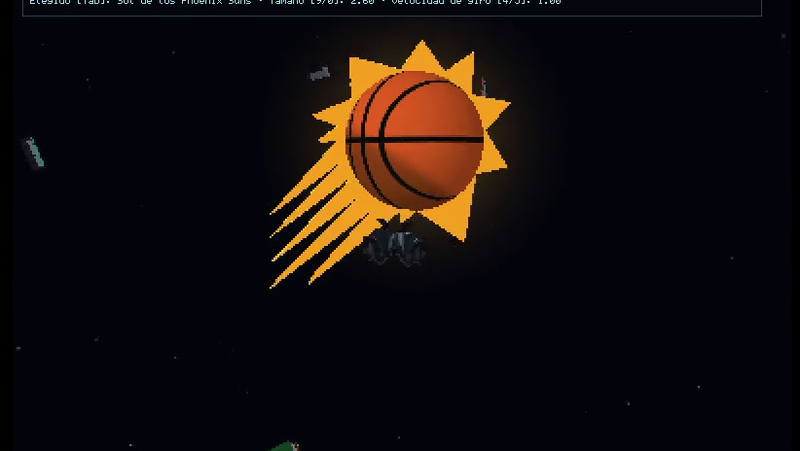 |  |

## Inicio rápido

1. Elige una opción en el menú principal con `W`/`S` o flechas y pulsa `Enter`.
2. En vuelo, acelera hacia adelante o atrás con `W`/`S` (mantén `Shift` para turbo) y frena con `Espacio`.
3. Gira la nave o la vista con el `Ratón` o las `Flechas`, e inclínala con `Q`/`E`.
4. Pulsa `F` para alternar entre seguir la nave y cámara libre, y `Retroceso` para recentrar.
5. Pulsa `H` en cualquier momento para abrir o cerrar el panel de ayuda, y `Esc` para volver al menú.

## Demostración

<<COMPLETAR: enlace al video>>

## Requisitos

- **Rust** (edición 2024, `cargo` y `rustc` estables).
- Dependencias de sistema para **Raylib** en Linux (Ubuntu/Debian):
  `cmake`, `libasound2-dev`, `libx11-dev`, `libxrandr-dev`, `libxi-dev`, `libgl1-mesa-dev`, `libglu1-mesa-dev`, `libxcursor-dev`, `libxinerama-dev`.
- Ejecutar siempre con `--release` (`opt-level = 3`, `lto = true`, `codegen-units = 1`) para mantener el rendimiento por encima de 30 FPS.

## Compilación y ejecución

```bash
# Ejecutar el simulador interactivo (resolución interna por defecto 400x300, ventana 800x600, hilos automáticos)
cargo run --release

# Ejecutar la suite de pruebas unitarias
cargo test

# Generar las capturas oficiales en docs/captures/ y docs/captures/ui/ (sin ventana)
cargo run --release -- --docs
```

## Controles

Tabla generada desde `CONTROLS` (`src/hud.rs`):

| Tecla | Acción |
|---|---|
| `W / S` | Acelerar hacia adelante o atrás |
| `Shift` | Turbo para ir más rápido |
| `Espacio` | Frenar poco a poco |
| `Ratón / Flechas` | Girar la vista (en cámara libre) |
| `Q / E` | Inclinar la nave a izquierda o derecha |
| `F / Retroceso` | Cambiar cámara (seguir / libre) · Recentrar |
| `L / G` | Control de vuelo (Auto/Cerca/Libre) · Gravedad |
| `Enter / - =` | Pausar el tiempo · Velocidad del tiempo |
| `Tab` | Elegir el siguiente objeto del sistema |
| `9 / 0` | Cambiar tamaño del objeto elegido |
| `4 / 5` | Ajustar el efecto visual del objeto elegido |
| `, . / [ ]` | Altura y detalle del relieve del planeta |
| `I / O` | Semilla (cambia el reparto aleatorio de objetos) |
| `Z / X / M` | Nivel de detalle · Descartar fuera de vista · Ver la malla (alambre) |
| `B / Y / /` | Relieve fino (normal map) · Ver relieve · Ocultar objetos lejanos |
| `F3 / R / T` | FPS (cuadros por segundo: mide la fluidez) · Calidad de imagen · Núcleos |
| `C / K / P` | Ocultar caras traseras · Recalcular texturas de superficie · Guardar foto |
| `A / D / R` | En galería: cambiar objeto · Reiniciar vista |
| `Esc` | Volver al menú principal (en el menú: salir) |
| `H` | Mostrar u ocultar este panel de ayuda |

## Arquitectura o pipeline

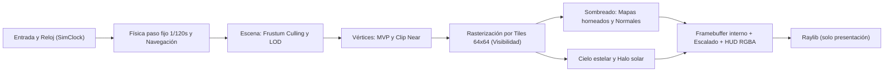

- **Buffer de visibilidad por tiles (`TILE_SIZE = 64`)**: primero se rasterizan todos los triángulos guardando `depth_buffer` y `tri_id_buffer`; el sombreado se ejecuta una sola vez por píxel visible, eliminando el *overdraw* de 2×.
- **Mapas estáticos horneados (`512×256`) + capa animada**: el relieve, biomas y gradientes estáticos se precalculan en mapas equirectangulares y en vivo solo se evalúan animaciones por `time`, atenuación solar y brillo atmosférico.
- **Raylib reducido a ventana, entrada y presentación**: ni la geometría, ni la iluminación, ni el texto del HUD usan funciones de dibujo 3D/texto de Raylib.

Más detalle: [docs/arquitectura.md](docs/arquitectura.md).

## Cuerpos del sistema solar (9)

| | | |
|:---:|:---:|:---:|
| <br>**Sol** (`Star`)<br>Estrella emisiva con granulación de manchas, corona animada, sin auto-sombra y halo solar en píxeles vacíos. | 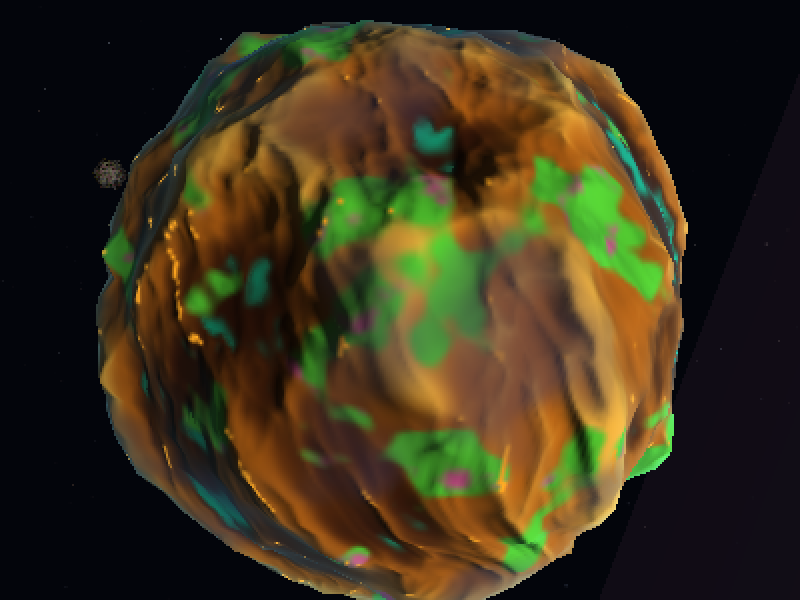<br>**Zebes** (`Rocky`)<br>Planeta rocoso con mar turquesa, biomas, grietas minerales, nubes vivas, relieve deformado y *normal mapping* tangente. | <br>**Tau Ceti** (`GasGiant`)<br>Gigante gaseoso con bandas latitudinales turbulentas y gran vórtice ciclónico animado en el hemisferio sur. |
| <br>**Ardens** (`Ardens`)<br>Placas basálticas Voronoi con relieve direccional y grietas de lava magenta-dorada que laten con géiseres emisivos. | 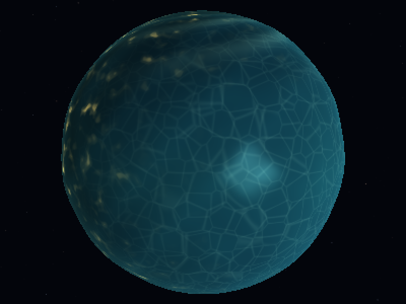<br>**Abismo** (`Abismo`)<br>Océano 3D con 4 ondas direccionales, cáusticas Voronoi dobles, *maelstrom* polar de 4 brazos y bioluminiscencia nocturna. | 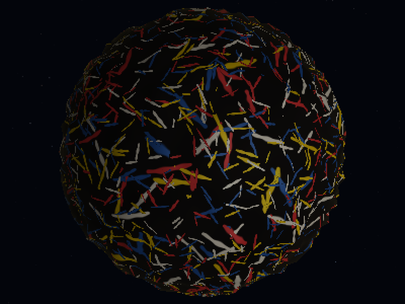<br>**Basquia** (`Basquia`)<br>Lienzo negro con trazos gruesos de *oilstick*/crayón por rejilla 3D, coronas de 3 puntas y conteos animados a ~6 FPS. |
| 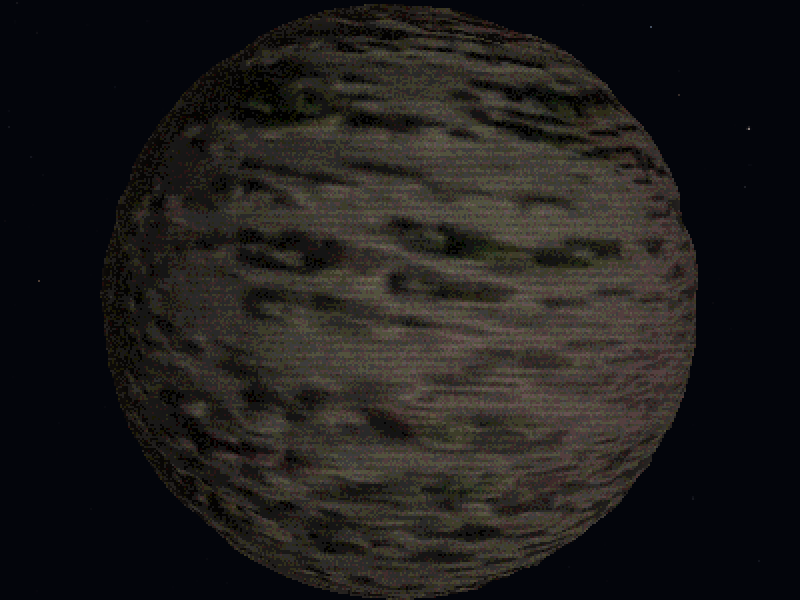<br>**Vestigio** (`Vestigio`)<br>Desierto oliva-rosa con dunas anisotrópicas 8×, 4 *dust devils* con estela, desfase cromático VHS, *scanlines* y grano. | 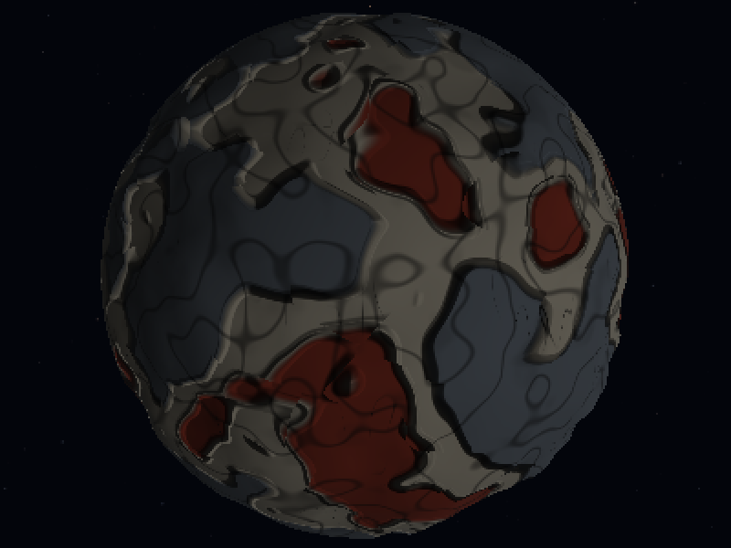<br>**Mural** (`Mural`)<br>Muro de pintura descascarada en 3 capas `fbm` 3D (gris azulado, crema, rojo), grietas *ridge*, tinta y escamas animadas. | 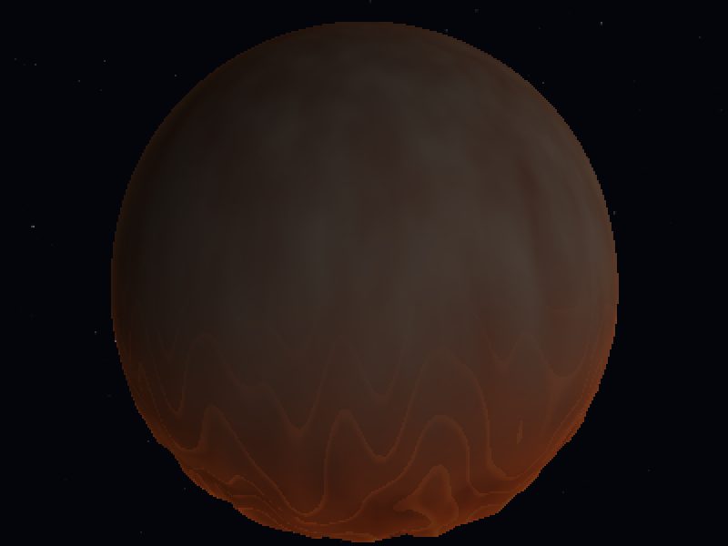<br>**Fundido** (`Fundido`)<br>Superficie en transición térmica con mitad superior salmón y bandas onduladas de magma naranja en el hemisferio sur. |

## Componentes principales

### Motor MVP y recorte
Construye las transformaciones de modelo (`T·R·S`), cámara (`look_at_rh`) y proyección perspectiva (`perspective_rh`) en mano derecha mirando hacia `-Z`, y recorta triángulos contra el plano cercano (`clip_near_plane`) antes de dividir por `w`.
- **Variable en código**: `fov_y = 45°`, `near = 0.1`, `far = 400.0` (`src/camera.rs`, `src/main.rs`) y `DEGENERATE_EPS = 1e-6` (`src/rasterizer.rs`).

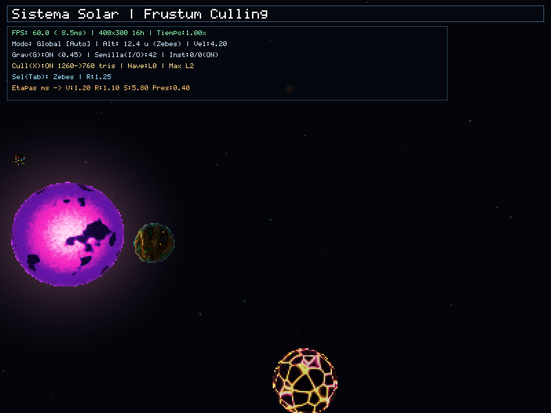

### Rasterizador y rendimiento
Divide la pantalla en *tiles* de `64×64` procesados en paralelo con `std::thread::scope` y utiliza un buffer de visibilidad (`depth_buffer` + `tri_id_buffer`) para sombrear una sola vez por píxel visible, descartando esferas fuera del frustum antes de ensamblar triángulos.
- **Variable en código**: `TILE_SIZE = 64` (`src/rasterizer.rs`) y `res_scales = [2, 3, 1]` (`src/main.rs`, tecla `R`).

| Culling ON | Culling OFF |
|:---:|:---:|
|  |  |

### Navegación
Integra movimiento 6-DOF y gravedad a paso fijo (`FIXED_DT`) independiente del FPS, usando colisión contra el radio efectivo deformado y cambio automático con histéresis entre marco global y marco local del planeta más cercano.
- **Variable en código**: `FIXED_DT = 1.0 / 120.0`, `GRAVITY_G = 7.2` (`src/physics.rs`) y `LOCAL_ENTER_RADII = 2.5` / `LOCAL_EXIT_RADII = 3.0` (`src/nav.rs`).

| Modo Local | Nave 3D |
|:---:|:---:|
|  | 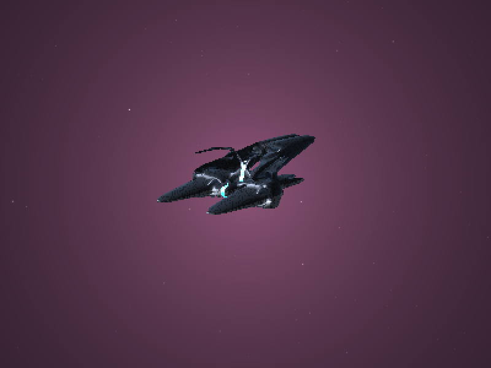 |

### Planetas y shaders
Orquesta los 9 cuerpos celestes con configuración centralizada (escalado de órbitas para un recorrido de ~1 min, atenuación solar con ambiente mínimo, halo solar en píxeles vacíos y brillo atmosférico Fresnel por planeta) y parámetro en vivo por shader.
- **Variable en código**: `ORBIT_DISTANCE_SCALE = 0.65`, `ORBIT_SPEED_SCALE = 1.15`, `MIN_AMBIENT = 0.14`, `SOLAR_ATTENUATION_K = 0.00055` (`src/scene_config.rs`) y `live_param` (`src/shaders.rs`, teclas `4`/`5`).

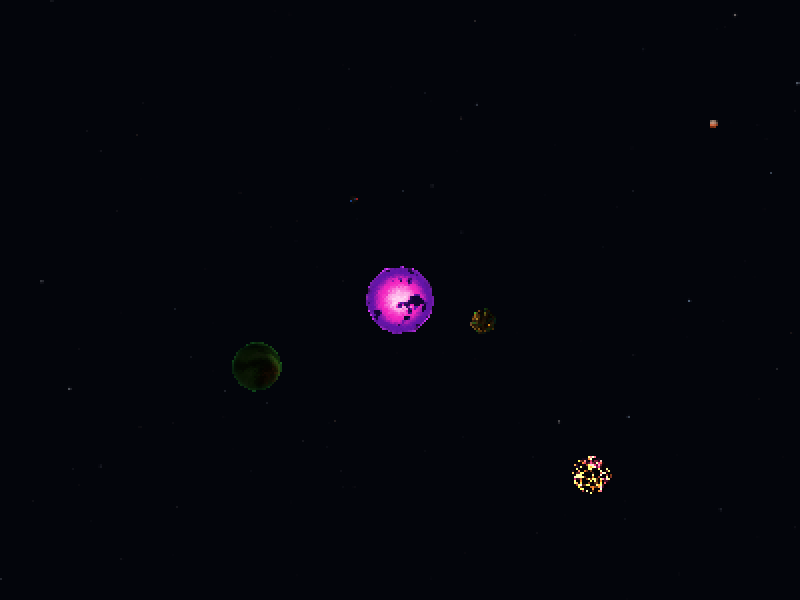

### Relieve y normales
Genera icosferas procedurales (`0..=5`) deformadas por la misma función `height_at` del horneado, selecciona el nivel LOD según el radio proyectado en pantalla con histéresis y perturba las normales en espacio tangente en `Zebes`.
- **Variable en código**: `ICOSPHERE_THRESHOLDS_PX = [8.0, 18.0, 40.0, 85.0, 160.0]`, `DEFAULT_HYSTERESIS = 0.12` (`src/lod.rs`) y `deformation_amplitude` / `noise_frequency` (`src/scene.rs`, teclas `,`/`.` y `[`/`]`).

| Normales ON | Deformación alta |
|:---:|:---:|
|  |  |

### Superficie
Distribuye instancias sobre la esfera con espiral de Fibonacci, perturbación `SplitMix64` y filtrado por ruido procedural, orientando cada objeto según la normal deformada y aplicando *frustum culling* y LOD por distancia.
- **Variable en código**: `surface_seed = 42` (`src/main.rs`, teclas `I`/`O`), `MAX_PROP_DISTANCE = 32.0` (`src/main.rs`) e `INSTANCE_LOD_DIST = 12.0` (`src/lod.rs`).

| Semilla 42 | Semilla 99 |
|:---:|:---:|
| 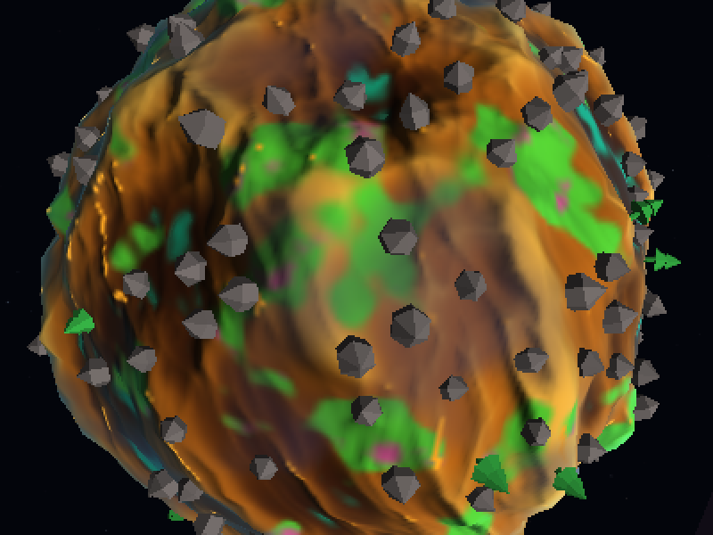 |  |

### HUD
Dibuja la barra de título, telemetría, contadores de culling/LOD, selección de cuerpos (`Tab`) y el panel de ayuda (`H`) mediante una fuente bitmap `5×7` propia sobre un `OverlayBuffer` RGBA compuesto al presentar sin texto de Raylib.
- **Variable en código**: `GLYPH_WIDTH = 5`, `GLYPH_HEIGHT = 7` y tabla `CONTROLS` (`src/hud.rs`).

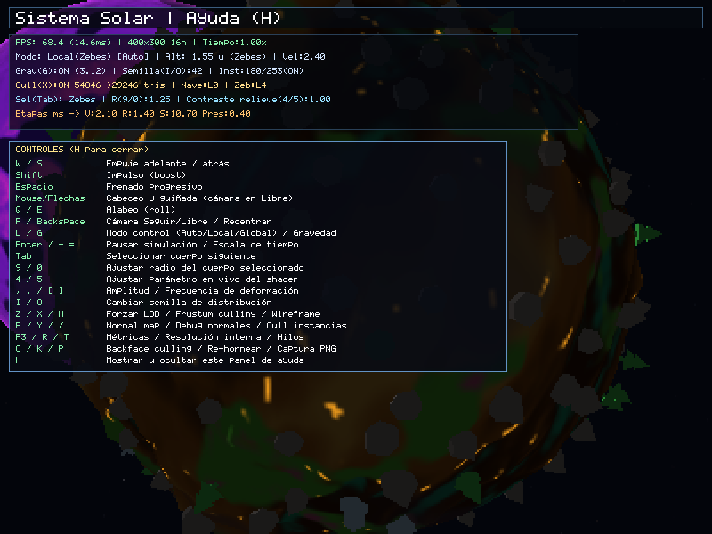

## Funcionalidades o criterios evaluables

| Criterio | Pts | Cumple | Dónde verlo | Archivo y función | Parámetro modificable |
|---|---:|:---:|---|---|---|
| Pipeline propio (MVP, clip near, backface, z-buffer, tiles) | 20 | ✅ | `culling_on.png` | `src/math.rs`, `src/clipping.rs::clip_near_plane`, `src/rasterizer.rs::rasterize_visibility_tiled` | `TILE_SIZE`, `R` |
| Icosfera procedural, deformación, normales y LOD | 15 | ✅ | `lod_cerca.png`, `normales_on.png`, `deform_alta.png` | `src/icosphere.rs::deform_icosphere_for_shader`, `src/lod.rs::select_detail_level_hysteresis` | `, / .`, `[ / ]`, `Z`, `B` |
| Frustum culling y rendimiento (>= 30 FPS) | 10 | ✅ | `culling_on.png` vs `culling_off.png` | `src/culling.rs::Frustum::from_vp`, `docs/rendimiento.md` | `X`, `R`, `T`, `F3` |
| Navegación 6-DOF, gravedad, colisión y modo local | 15 | ✅ | `modo_local.png` | `src/physics.rs::PhysicsStepper`, `src/nav.rs::NavState` | `G`, `L`, `GRAVITY_G` |
| Cuerpos celestes (máx. 5 puntuables) y shaders (máx. 4) | 20 | ✅ | `sistema_completo.png` + 9 capturas | `src/scene.rs::solar_system`, `src/shaders/*.rs` | `Tab`, `9 / 0`, `4 / 5` |
| Distribución procedural en superficie y modelos 3D | 10 | ⚠️ (6) | `semilla_42.png`, `semilla_99.png` | `src/surface_scatter.rs::scatter_for_body`, `src/surface_props.rs::load_surface_props` | `I / O`, `/` |
| Nave 3D con LODs | 5 | ✅ | `nave.png` | `src/mesh_lod.rs::load_ship_lods`, `assets/ship_lod{0,1,2}.obj` | `Z` / distancia |
| HUD propio (sin texto raylib), controles en vivo y docs | 10 | ✅ | `ayuda_hud.png` | `src/hud.rs::render_hud`, `src/docs_capture.rs` | `H`, `Tab`, `9/0`, `4/5` |

- **Total bruto**: **101 / 105**
- **Total (`min(100, total)`)**: **100 / 100** (detalle completo en [docs/auditoria-rubrica.md](docs/auditoria-rubrica.md)).
- **Características evaluables**: pipeline por software sin rasterizado/texto de Raylib, icosfera deformada con LOD y normales, frustum culling con contadores, navegación 6-DOF con gravedad y modo local, 9 shaders procedurales distintos con capa estática + viva, distribución Fibonacci + ruido sobre superficie, y HUD propio con ajuste de parámetros en vivo.

## Verificación de reglas

1. **Sin funciones 3D ni texto de Raylib para renderizar/HUD**: ✅ Cumplido; Raylib solo crea la ventana, lee entrada y presenta las dos texturas (`framebuffer` + `OverlayBuffer` en `src/framebuffer.rs::draw_with_overlay`).
2. **Mínimo 30 FPS a resolución interna por defecto (`400×300`)**: ✅ Cumplido (`58.6–135.5 FPS` en `docs/rendimiento.md` y `36.5–217.9 FPS` en los shaders nuevos).
3. **Al menos 5 planetas y 4 shaders procedurales distintos**: ✅ Cumplido (1 estrella + 8 planetas con 9 shaders distintos sin repetir técnicas).
4. **Una sola función `height_at` para deformación, horneado y normales**: ✅ Cumplido (`src/surface_map.rs::shader_height` alimenta `deform_icosphere_for_shader`, `BakedMaps` y `surface_point_and_normal`).
5. **Distribución procedural reproducible sin posiciones hardcodeadas**: ✅ Cumplido (`src/rng.rs::SplitMix64` + `src/surface_scatter.rs::fibonacci_sphere_points`).

## Estructura del proyecto

```text
proy3-graficas/
├── .github/workflows/ci.yml
├── assets/
│   ├── ship.obj
│   └── sphere.obj
├── docs/
│   ├── captures/                # 23 capturas oficiales (--docs)
│   ├── arquitectura.md
│   ├── auditoria-paletas.md
│   ├── auditoria-rubrica.md
│   ├── blender.md
│   ├── defensa.md
│   ├── guion-video.md
│   ├── rendimiento.md
│   └── reuse-audit.md
├── src/
│   ├── camera.rs
│   ├── clipping.rs
│   ├── culling.rs
│   ├── docs_capture.rs
│   ├── fragment.rs
│   ├── framebuffer.rs
│   ├── hud.rs
│   ├── icosphere.rs
│   ├── lod.rs
│   ├── main.rs
│   ├── math.rs
│   ├── mesh_lod.rs
│   ├── nav.rs
│   ├── noise.rs
│   ├── obj.rs
│   ├── perf.rs
│   ├── physics.rs
│   ├── primitive.rs
│   ├── rasterizer.rs
│   ├── rng.rs
│   ├── scene.rs
│   ├── scene_config.rs
│   ├── shaders/                 # star, rocky, gas_giant, ardens, abismo, basquia, vestigio, mural, fundido, ship
│   ├── shaders.rs
│   ├── ship.rs
│   ├── sim.rs
│   ├── sky.rs
│   ├── surface_map.rs
│   ├── surface_props.rs
│   ├── surface_scatter.rs
│   └── vertex.rs
├── Cargo.toml
└── README.md
```

## Limitaciones conocidas

- Los 4 modelos `.obj` de superficie (`assets/surface/{tree,rock,building,monument}.obj`) no han sido agregados aún; el motor utiliza los marcadores procedurales de respaldo de `src/surface_props.rs`.
- Los LOD de la nave (`assets/ship_lod0.obj`, `ship_lod1.obj`, `ship_lod2.obj`, con `3000`/`800`/`610` triángulos) ya se cargan desde archivo; el respaldo por decimación en `src/mesh_lod.rs::load_ship_lods` se mantiene únicamente si faltaran.
- El menú principal, la galería de trofeos y el vuelo en ambos sistemas (`Sistema solar realista` y `Sistema de favoritos`) están activos (`FAVORITES_FLIGHT_ENABLED = true`). El sistema de favoritos cuenta con 13 cuerpos `Ready` (`Sol de los Phoenix Suns` al centro más 12 cuerpos en órbita sin solapamientos: `Cubo de Rubik`, `Cubo Skewb`, `Trifuerza`, `Joy-Con izquierdo`, `Joy-Con derecho`, `AirPods`, `Casco de Samus`, `Megaminx`, `Raqueta de tenis`, `La Bombonera`, `Cresta del Tottenham` y `Meteoro de FF7`).

## Dependencias principales

- `raylib = "6.0.0"` (con `SUPPORT_IMAGE_GENERATION`): ventana, lectura de teclado/ratón, carga/actualización de textura y exportación de PNG.
- Biblioteca estándar de Rust (`std::thread::scope`): paralelismo por bandas/tiles sin dependencias externas.

## Uso de IA y recursos externos

- Los logotipos, escudos, personajes, consolas y marcas comerciales representados en la galería y el sistema de favoritos (Phoenix Suns, Tottenham Hotspur, Apple AirPods, Nintendo Switch Joy-Con, Rubik, The Legend of Zelda, Final Fantasy VII, Wilson, Metroid y Boca Juniors) pertenecen a sus respectivos dueños y se utilizan únicamente con fines académicos y de demostración gráfica.

## Autor

**Marcelo Detlefsen** - Carné 24554  
*Universidad del Valle de Guatemala*  
*Gráficas por Computadora - Proyecto 3*
